<a id="top"></a>

<picture>
  <source media="(prefers-color-scheme: dark)" srcset="images/readme/banner-dark.png">
  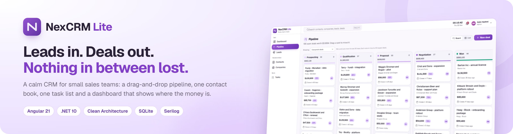
</picture>

<p align="center">
  
  
  
  
  
</p>
<p align="center">
  
  
  
  
</p>

<p align="center">
  <a href="#-quick-start"><b>Quick start</b></a> ·
  <a href="#-a-tour-of-the-app"><b>Tour</b></a> ·
  <a href="#-screenshot-gallery"><b>Gallery</b></a> ·
  <a href="#-architecture"><b>Architecture</b></a> ·
  <a href="#-security"><b>Security</b></a> ·
  <a href="#-testing-and-performance"><b>Performance</b></a> ·
  <a href="DESIGN.md"><b>Design</b></a>
</p>

<br>

<p align="center">
  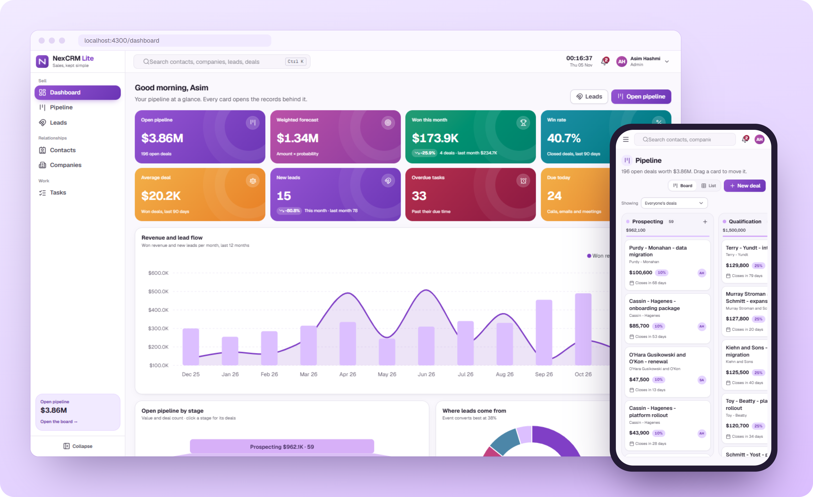
</p>

<br>

**NexCRM Lite** is a small, fast CRM for sales teams of two to twenty. Leads come in from every channel, and one click turns a qualified lead into a contact, a company and a deal on the pipeline board. Drag the deal across the board until it closes, and the dashboard shows where the money is and which calls are overdue.

It is the portfolio-sized sibling of **NexCRM**, a multi-tenant CRM platform. The Lite version keeps the parts a small team uses every day and drops the rest. It is still built the way production software should be: Clean Architecture, a rich domain model, one generic CRUD pipeline, tests written first, a pentest with every finding fixed and retested, and a load test that found (and fixed) the query that would have taken it down.

<table>
  <tr>
    <td align="center" width="25%"><h2>46</h2><sub>API endpoints, each behind a JWT<br>and server-side validation</sub></td>
    <td align="center" width="25%"><h2>0 errors</h2><sub>with 1,000 users arriving<br>in 30 seconds</sub></td>
    <td align="center" width="25%"><h2>6 ms</h2><sub>dashboard, down from 5.9 s<br>after the load-test fixes</sub></td>
    <td align="center" width="25%"><h2>~20 s</h2><sub>to seed 46,000 records and<br>4,000 users for a load test</sub></td>
  </tr>
</table>

<br>

## ✦ Highlights

<table>
  <tr>
    <td width="33%" valign="top">
      <h3>🗂️ A pipeline you can drag</h3>
      Six stages from Prospecting to Won and Lost. Drop a card in a new column and its probability, weighted value and close date update instantly, then the server confirms. Totals per column always cover every deal.
    </td>
    <td width="33%" valign="top">
      <h3>🧲 Leads that convert</h3>
      Score leads from 0 to 100, track their source and qualify them. Convert reuses an existing company or contact when one already matches, so the address book never duplicates.
    </td>
    <td width="33%" valign="top">
      <h3>✅ Nothing slips</h3>
      Calls, emails, meetings and follow-ups with priorities. Overdue work turns red, the bell shows what's new since you last looked, and ticking a task off updates the contact's last touch.
    </td>
  </tr>
  <tr>
    <td width="33%" valign="top">
      <h3>📊 A dashboard that answers</h3>
      Eight KPI tiles, revenue against lead flow, a pipeline funnel, lead sources, a rep leaderboard and deals closing this month. Every tile and chart segment opens the records behind it.
    </td>
    <td width="33%" valign="top">
      <h3>🧮 One grid, everywhere</h3>
      Global search, per-column search, an AND / OR filter builder, sort, column chooser, totals across all filtered rows, and Excel or CSV export of exactly what you see.
    </td>
    <td width="33%" valign="top">
      <h3>🛡️ Secure by default</h3>
      Revocable JWT sessions, account lockout, role-checked deletes and reassignments, an audit log of every sensitive action, per-user rate limits, idempotent creates and duplicate-proof records. Pentested, every finding fixed.
    </td>
  </tr>
</table>

<br>

## ✦ Quick start

> [!NOTE]
> **You need** the .NET SDK 10 and Node.js 22.12+. There is no database to install: SQLite lives in `src/NexCrm.Api/App_Data`.

**1. Start the API** on <http://localhost:5090>. On first run it applies the migration and seeds a year of demo data. Swagger is at `/swagger` and the health check at `/health`.

```bash
cd src/NexCrm.Api
```

```bash
dotnet run --launch-profile http
```

**2. Start the client** in a second terminal, then open <http://localhost:4300>.

```bash
cd client
```

```bash
npm install
```

```bash
npm start
```

**3. Sign in.** Demo mode lists the accounts on the sign-in page; click one. The password is the same as the username.

| Username | Role | Can do |
|---|---|---|
| `admin` | Admin | Everything, including deleting records |
| `manager` | Manager | Every record, deletes allowed |
| `sara`, `bilal`, `omer`, `ayesha` | Sales rep | Leads, deals, contacts, companies and tasks; no deletes |

<details>
<summary><b>Configuration, secrets and production build</b></summary>

<br>

**Fresh demo data.** Drops the database and seeds a new year of history (the same seed always gives the same data):

```bash
dotnet run -- seed
```

**Secrets.** No key is committed. In Development the API creates a random signing key in `App_Data/dev-signing.key` on first run (git-ignored). Anywhere else, set the key outside the repo:

```bash
dotnet user-secrets set "Jwt:SigningKey" "a-random-string-of-at-least-32-characters"
```

**Behind a reverse proxy.** List the proxy's address in `Network:KnownProxies`; only then does the API trust `X-Forwarded-For`, which the per-address sign-in lock relies on.

**Production build.** Build the client, copy `client/dist` into `src/NexCrm.Api/wwwroot`, and the API serves the app with a fallback to `index.html` for client routes.

```bash
cd client && npx ng build
```

</details>

<p align="right"><a href="#top">↑ back to top</a></p>

## ✦ A tour of the app

<table>
  <tr>
    <td width="42%" valign="top">
      <h3>Dashboard</h3>
      <p>The morning view for a sales lead. Eight gradient KPI tiles compare this month with the last.</p>
      <ul>
        <li>Open pipeline, weighted forecast, won this month, win rate</li>
        <li>Average deal, new leads, overdue tasks and tasks due today</li>
        <li>Every tile opens the filtered records behind its number</li>
      </ul>
    </td>
    <td width="58%">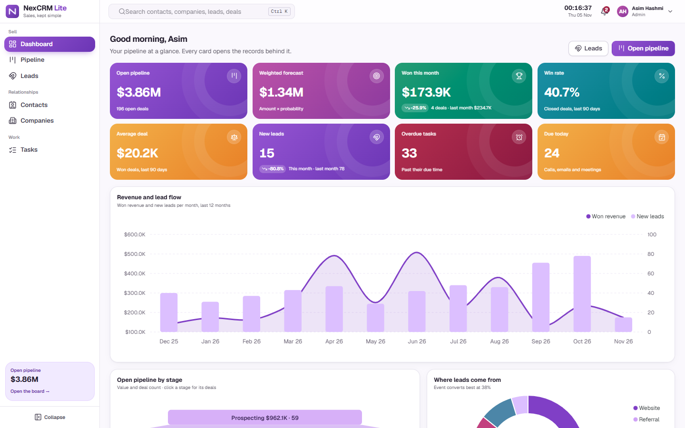</td>
  </tr>
  <tr>
    <td width="58%">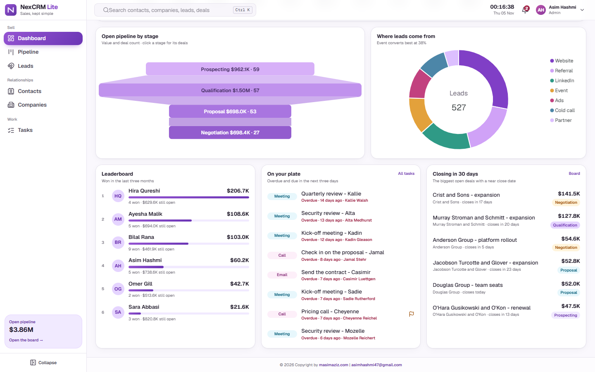</td>
    <td width="42%" valign="top">
      <h3>Where the money is</h3>
      <p>The lower half answers the next three questions.</p>
      <ul>
        <li>A funnel of the open pipeline by stage; click a stage for its deals</li>
        <li>Lead sources, with the best converting channel called out</li>
        <li>A leaderboard, your plate for the next three days, and big deals closing this month</li>
      </ul>
    </td>
  </tr>
  <tr>
    <td width="42%" valign="top">
      <h3>Pipeline board</h3>
      <p>Drag a card to move a deal. The board updates at once and rolls back if the server says no.</p>
      <ul>
        <li>Each stage sets its usual probability: 10, 25, 50, 75, 100 or 0%</li>
        <li>Won and Lost stamp the close date; reopening clears it</li>
        <li>Overdue close dates turn red; filter the board by owner</li>
      </ul>
    </td>
    <td width="58%">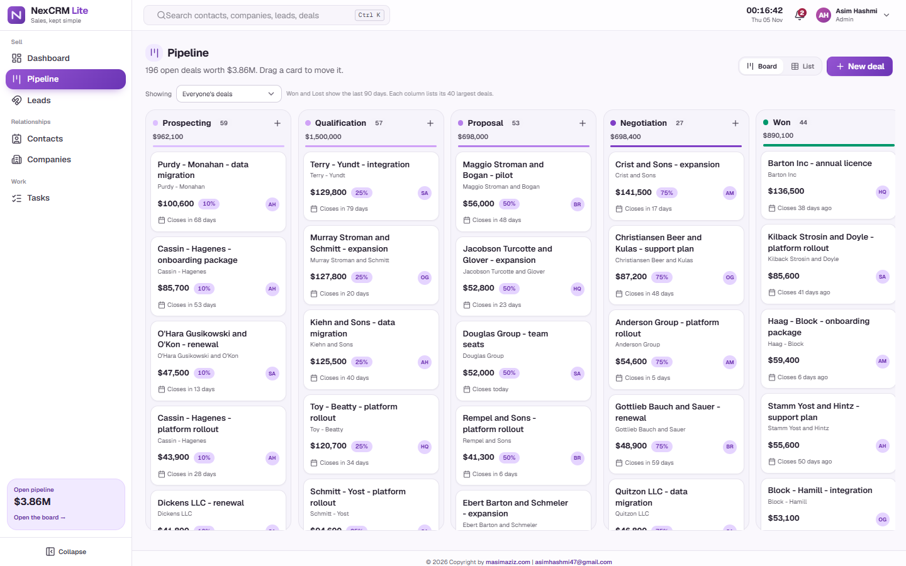</td>
  </tr>
  <tr>
    <td width="58%">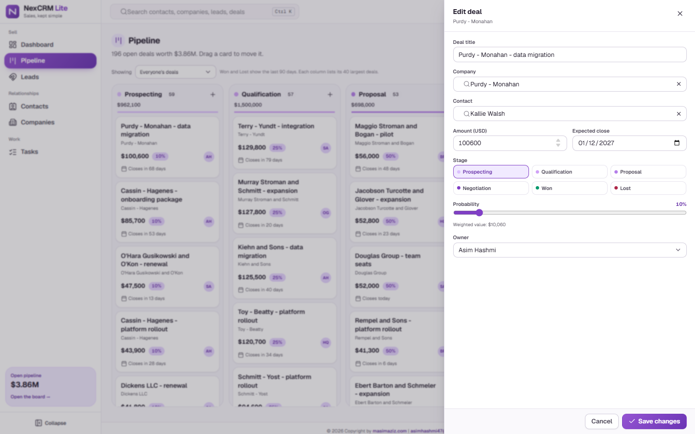</td>
    <td width="42%" valign="top">
      <h3>Deal editor</h3>
      <p>Forms open in a right-hand drawer, so the board or the list stays in view.</p>
      <ul>
        <li>Type-ahead pickers for company and contact</li>
        <li>The probability slider shows the weighted value as you drag</li>
      </ul>
    </td>
  </tr>
  <tr>
    <td width="42%" valign="top">
      <h3>Leads and conversion</h3>
      <p>Score, source and status at a glance. Convert asks once, then creates everything the deal needs.</p>
      <ul>
        <li>Reuses a company by name and a contact by email</li>
        <li>A converted lead becomes read-only history</li>
        <li>Unqualified leads must be requalified first</li>
      </ul>
    </td>
    <td width="58%">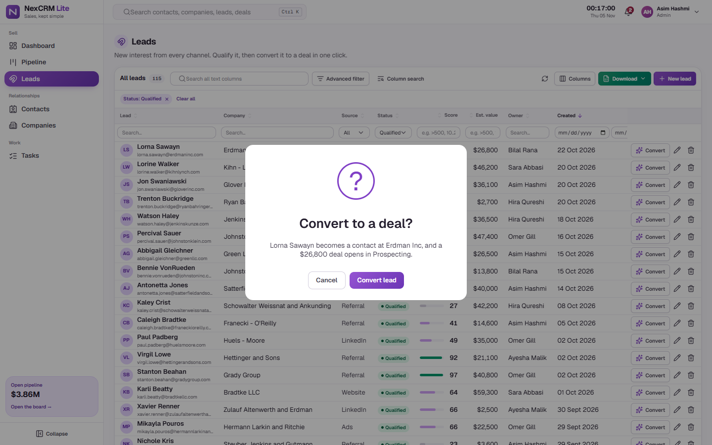</td>
  </tr>
  <tr>
    <td width="58%">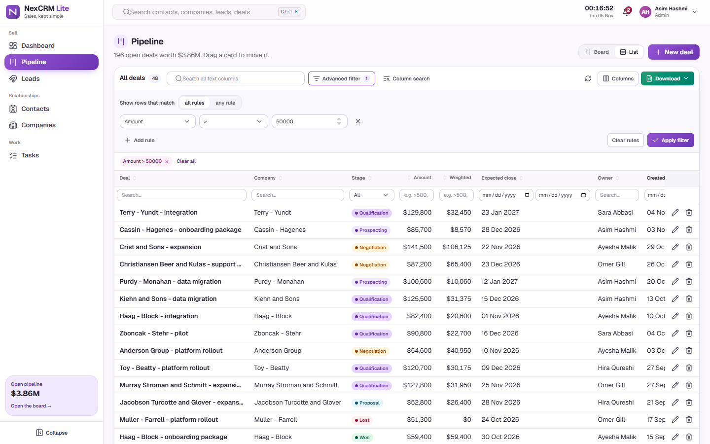</td>
    <td width="42%" valign="top">
      <h3>One grid, everywhere</h3>
      <p>Every list in the app uses the same data table:</p>
      <ul>
        <li>Global search, a search row per column, AND / OR rule builder</li>
        <li>Sort, column chooser, totals across all filtered rows</li>
        <li><b>Export the filtered rows</b> to Excel or CSV</li>
        <li>Paging, filtering and totals run in SQL on the server</li>
      </ul>
    </td>
  </tr>
  <tr>
    <td width="42%" valign="top">
      <h3>Tasks</h3>
      <p>Open, due today, overdue and done, one tab each.</p>
      <ul>
        <li>Tick a task off from the row</li>
        <li>Overdue rows are tinted and say how late they are</li>
        <li>Links from the bell and dashboard land on the right tab</li>
      </ul>
    </td>
    <td width="58%">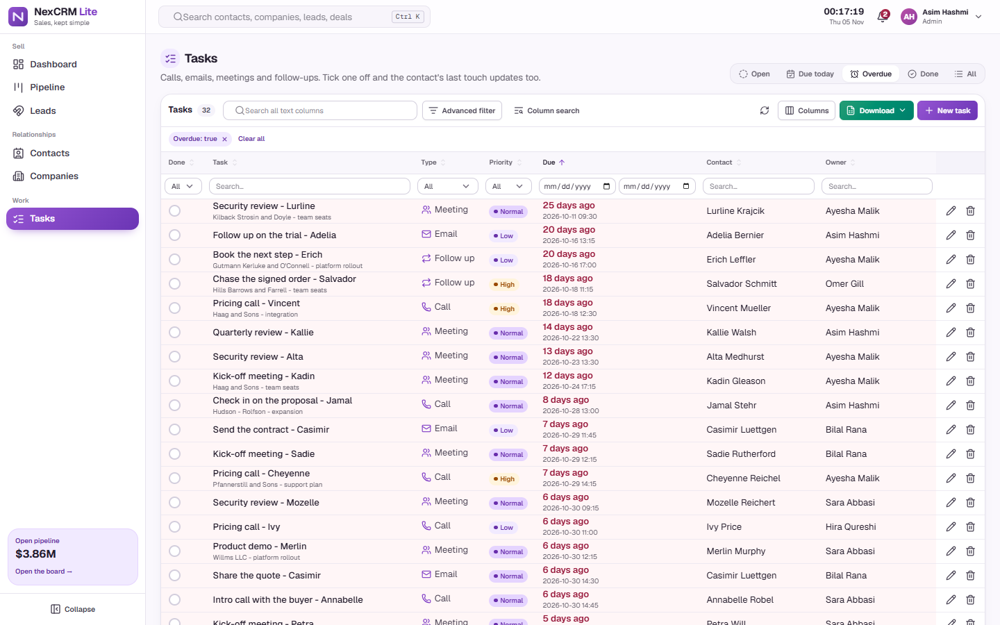</td>
  </tr>
  <tr>
    <td width="58%">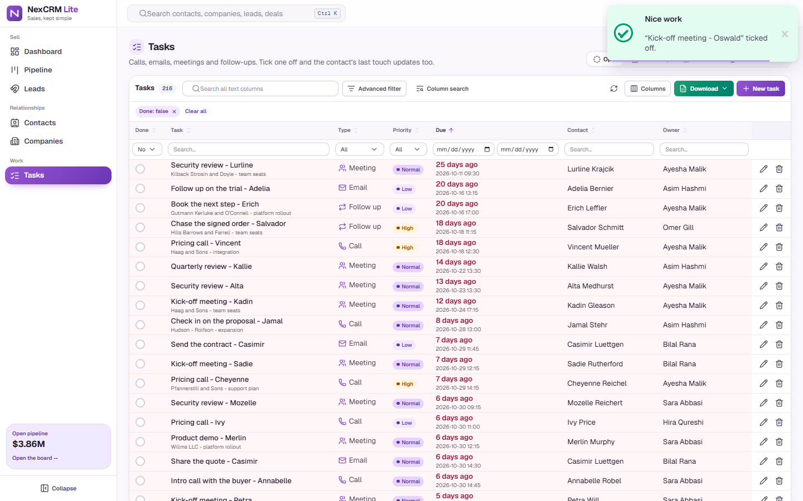</td>
    <td width="42%" valign="top">
      <h3>Feedback you can read</h3>
      <p>SweetAlert2 toasts sit top right for 10 seconds with a progress bar, pause on hover, and are tinted by type.</p>
      <ul>
        <li>Server errors show the ProblemDetails message, not a status code</li>
        <li>All toast text is rendered as text, never HTML</li>
      </ul>
    </td>
  </tr>
</table>

<p align="right"><a href="#top">↑ back to top</a></p>

## ✦ Screenshot gallery

<details>
<summary><b>All 20 screens</b> (click to expand)</summary>

<br>

| | |
|:---:|:---:|
| 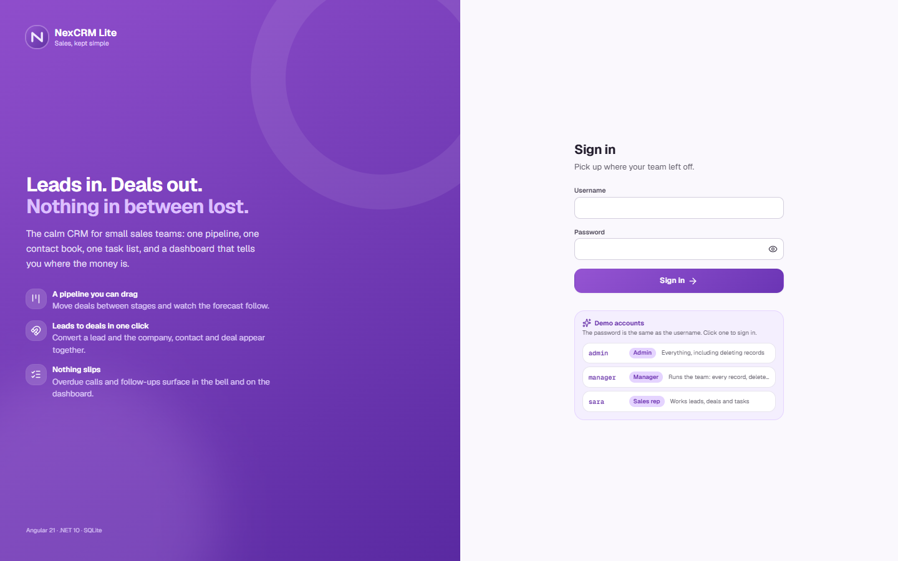<br><sub><b>Sign in</b> with demo accounts</sub> | <br><sub><b>Dashboard</b>: every tile opens its records</sub> |
| <br><sub><b>Funnel</b>, sources and leaderboard</sub> | <br><sub><b>Pipeline</b> board</sub> |
| <br><sub><b>Deal editor</b> drawer</sub> | 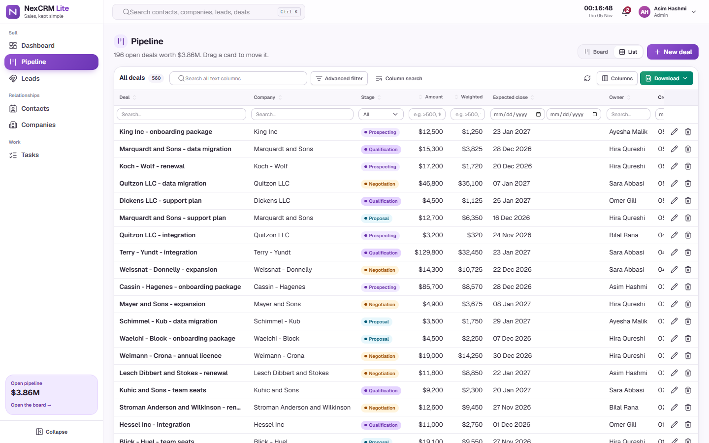<br><sub><b>Deals</b> list with totals</sub> |
| <br><sub><b>Advanced filter</b> builder</sub> | 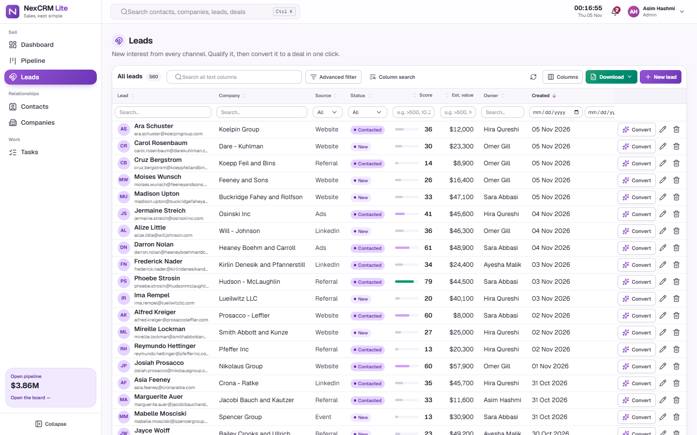<br><sub><b>Leads</b> with scores</sub> |
| <br><sub><b>Convert</b> a lead</sub> | 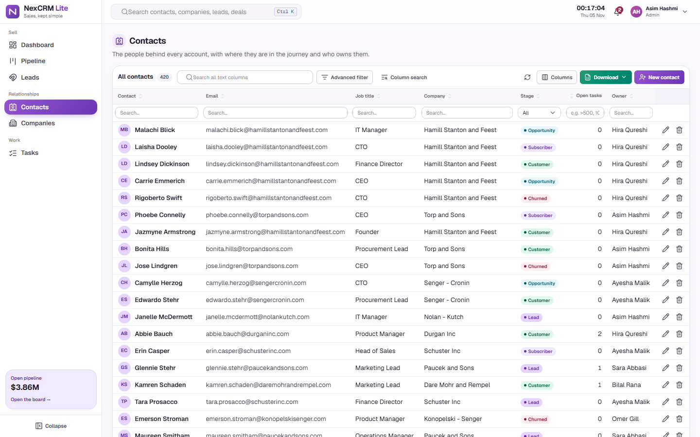<br><sub><b>Contacts</b></sub> |
| 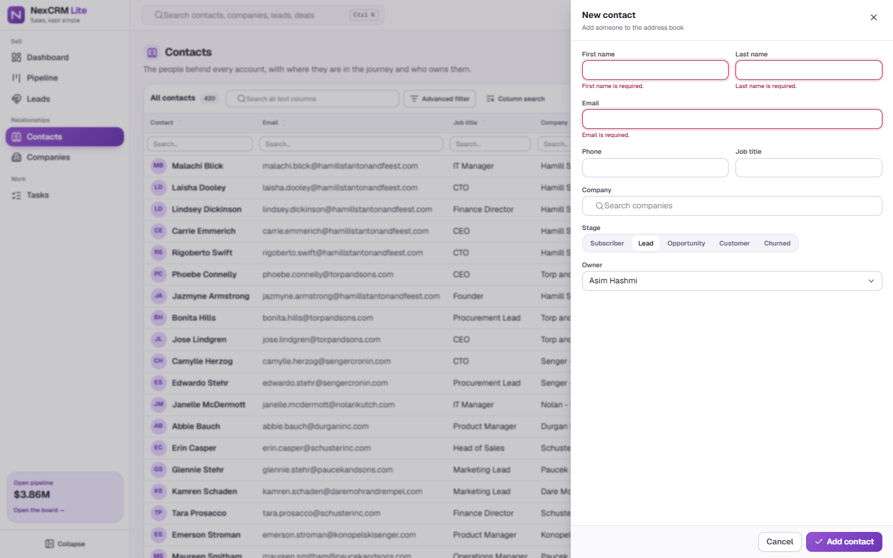<br><sub><b>Validation</b> in the drawer</sub> | <br><sub><b>Companies</b> with won revenue</sub> |
| 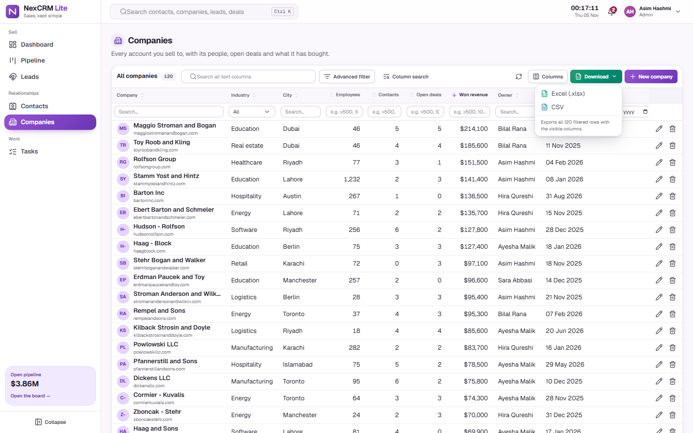<br><sub><b>Export</b> to Excel or CSV</sub> | 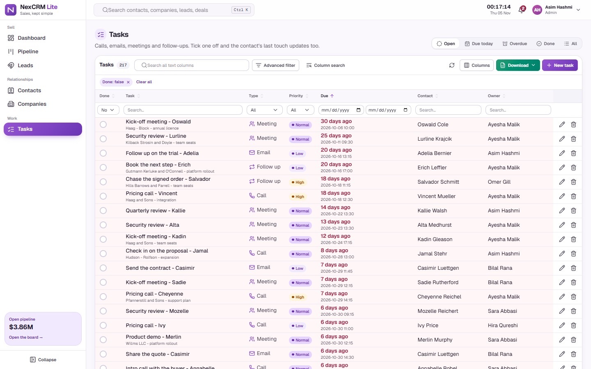<br><sub><b>Tasks</b></sub> |
| <br><sub><b>Toast</b> with a 10 s progress bar</sub> | <br><sub><b>Overdue</b> tasks</sub> |
| 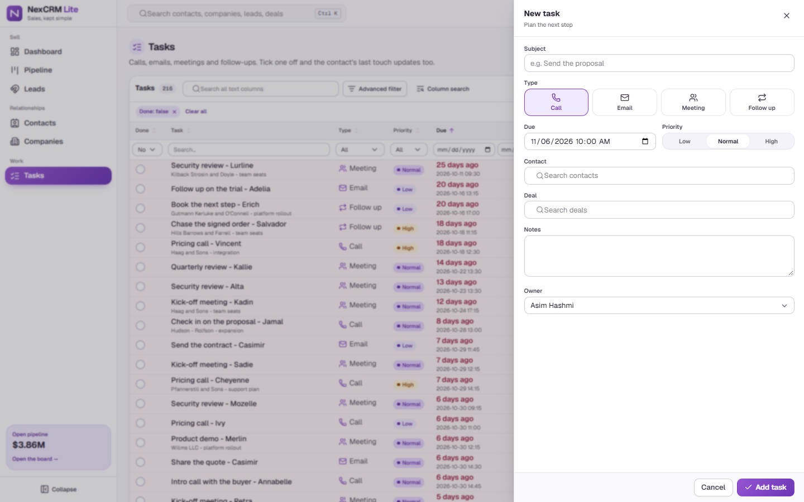<br><sub><b>Task editor</b></sub> | 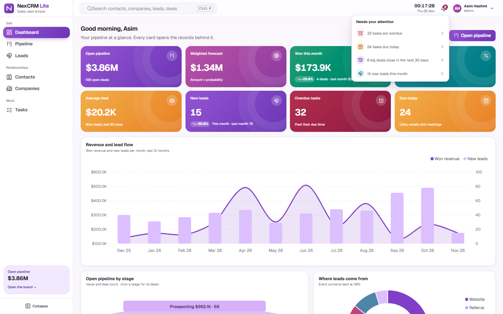<br><sub><b>Notifications</b> bell</sub> |
| 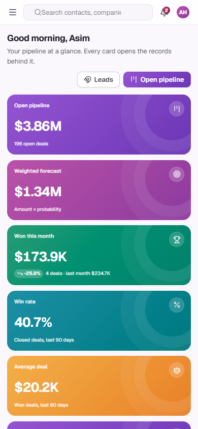<br><sub><b>Phone</b>: dashboard</sub> | 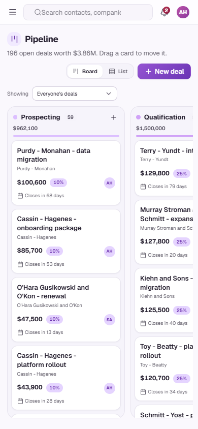<br><sub><b>Phone</b>: pipeline</sub> |

</details>

<p align="right"><a href="#top">↑ back to top</a></p>

## ✦ Tech stack

<table>
  <tr>
    <th align="left" width="50%">Backend</th>
    <th align="left" width="50%">Frontend</th>
  </tr>
  <tr>
    <td valign="top">
      <b>.NET 10</b> and ASP.NET Core Web API<br>
      <b>Clean Architecture</b>: Domain ← Application ← Infrastructure ← Api<br>
      <b>EF Core 10</b> on <b>SQLite</b>, with migrations<br>
      <b>Serilog</b> to the console and a daily rolling file<br>
      <b>FluentValidation</b> on every request<br>
      <b>ClosedXML</b> for Excel exports<br>
      <b>Bogus</b> for a reproducible demo year<br>
      <b>Swagger</b> with a JWT button, and health checks<br>
      <sub>No MediatR and no AutoMapper: a generic service base and hand-written projections.</sub>
    </td>
    <td valign="top">
      <b>Angular 21</b>: standalone components, signals, new control flow, zoneless<br>
      <b>Tailwind CSS 4</b> with OKLCH design tokens<br>
      <b>ApexCharts</b> for the dashboard<br>
      <b>SweetAlert2</b> for toasts and confirmations<br>
      <b>Lucide</b> icons, tree-shaken to the 69 the app uses<br>
      <b>Geist</b> variable font, self-hosted<br>
      Native HTML5 drag and drop for the board
    </td>
  </tr>
  <tr>
    <th align="left">Quality</th>
    <th align="left">Tooling</th>
  </tr>
  <tr>
    <td valign="top">
      <b>xUnit</b> unit tests on a real in-memory SQLite database<br>
      <b>WebApplicationFactory</b> integration tests on a throwaway SQLite file<br>
      Node's built-in test runner for the client and the browser journeys<br>
      A Node load generator and a pentest probe suite
    </td>
    <td valign="top">
      Central NuGet package management, warnings as errors<br>
      Angular CLI build with strict templates<br>
      <code>dotnet format</code> and Prettier checks<br>
      Headless Chrome scripts that regenerate every image in this README
    </td>
  </tr>
</table>

## ✦ Architecture

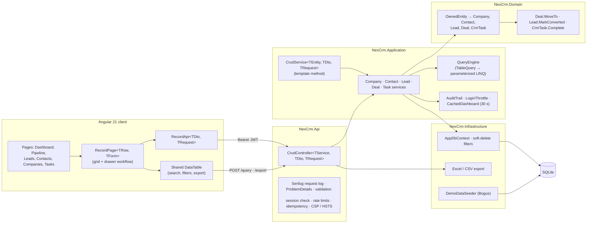

### The life of a lead

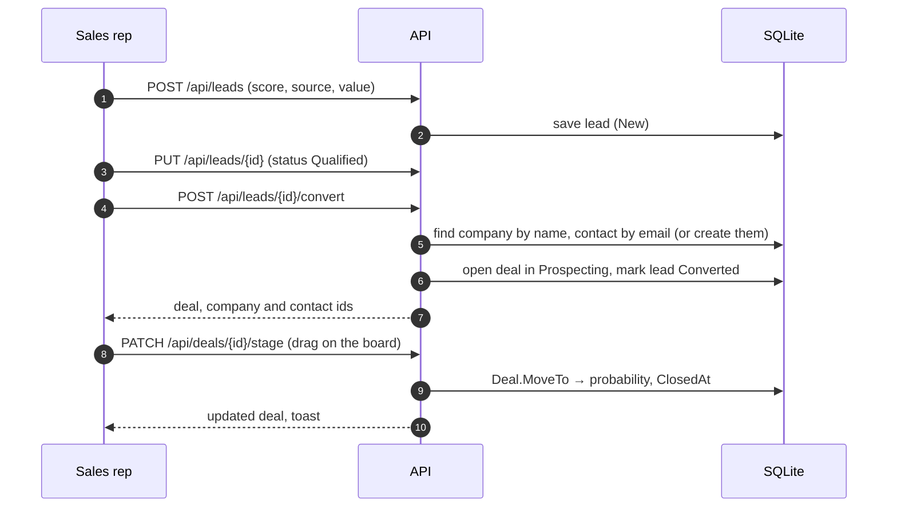

### Pipeline rules

All stage logic lives on the `Deal` entity, so the board, the drawer and the seeder follow the same rules.

| Rule | Behaviour |
|---|---|
| Default probability | Prospecting 10%, Qualification 25%, Proposal 50%, Negotiation 75%, Won 100%, Lost 0% |
| Forecast override | Reps may set their own probability on **open** deals; closed deals stay at 0 or 100 |
| Closing | Moving to Won or Lost stamps `ClosedAt`; moving back to an open stage clears it |
| Weighted value | Amount × probability ÷ 100, computed in SQL for grids and the dashboard |
| Board | Open stages show every deal; Won and Lost show the last 90 days. Each column lists its 40 largest deals, while counts and totals cover them all |

### OOP in practice


The code favours a few well-named abstractions over repetition.

<details>
<summary><b>Backend: template method, generics and a rich domain</b></summary>

<br>

- **`OwnedEntity`** is the abstract base for every CRM record. It owns `OwnerId` and the archive flag, and `Archive()` is the only way to set it.
- **Entities guard their own rules.** `Deal.Stage`, `Probability` and `ClosedAt` have private setters, so `MoveTo()` and `Forecast()` are the only ways to change them. `Lead.MarkConverted()` refuses a second conversion.
- **`CrudService<TEntity, TDto, TRequest>`** runs the save workflow (find, check owner, validate, map, save, re-read). Each feature overrides only `Query()`, `Apply()` and the hooks it needs: `ValidateAsync` for duplicate checks, `BeforeArchiveAsync` to block deleting a company with open deals.
- **`CrudController<TService, TDto, TRequest>`** gives every record the same six endpoints. A feature controller is three lines plus any extra actions (`convert`, `board`, `stage`, `done`).
- **One mapping base** (`OwnedEntityConfiguration<T>`) indexes owners and archive flags for every table, and a model-wide convention applies the soft-delete filter.

</details>

<details>
<summary><b>Frontend: the same shape on the client</b></summary>

<br>

- **`RecordApi<TDto, TRequest>`** is an abstract service; `CompanyApi`, `DealApi` and the others extend it and add their own calls.
- **`RecordPage<TRow, TForm>`** is an abstract directive that owns the grid-and-drawer workflow: open, edit, validate, save, map server errors onto fields, confirm, delete and refresh. A page supplies the form, `toForm()`, `blank()` and `describe()`.
- **`LookupSelect`** implements `ControlValueAccessor`, so the company, contact and deal pickers work with `formControlName` like any input.

</details>

<p align="right"><a href="#top">↑ back to top</a></p>

## ✦ Security

Pentested with 25 probes; all 15 actionable findings were fixed with a failing test first and retested (14 open before, 0 after). The full write-up, with each finding's proof, fix and before/after evidence, is in [security/SECURITY-REVIEW.md](security/SECURITY-REVIEW.md).

<details>
<summary><b>Authentication and sessions</b></summary>

- PBKDF2 password hashing (the ASP.NET Core Identity hasher). An unknown username costs the same hashing work, so response timing does not reveal valid ones.
- Five failed sign-ins for one account from one address lock that pair for 15 minutes, so a stranger cannot lock the real user out from their own desk. Twenty failures from anywhere lock the account. Locked means locked, even with the right password.
- Sign-in is also rate limited per address. `X-Forwarded-For` is trusted only from proxies listed in config.
- Every token carries a session version. Signing out bumps it, so every token issued so far stops working. Every request re-checks that the account is still active, so deactivating a user cuts them off at once.
- No signing key is committed. Development generates its own in `App_Data` on first run; anywhere else the API refuses to start without one.

</details>

<details>
<summary><b>Authorization and data</b></summary>

- Every endpoint requires a JWT (fallback policy); only sign-in, auth config and health are anonymous. Hiding UI is cosmetic only.
- Only admins and managers may delete, or move a colleague's record to another owner. Enforced in the service layer. Deletes are soft, so history survives.
- An audit log records creates, updates (with owner changes), deletes, lead conversions, stage moves, exports, sign-ins, failed sign-ins and sign-outs, with user, time and address. Admins read it on the Audit log page.
- Company names and contact emails are unique in the database itself, so 50 simultaneous creates make exactly one record. Lead conversion runs in one transaction with a concurrency token, so a double click never opens two deals.
- `Idempotency-Key` on POST: a retried create returns the first result; the same key with a different body is refused with 422. The client sends one per form.
- FluentValidation on every request DTO, with maximum lengths and sensible date ranges. Explicit DTOs only, so there is no over-posting.
- Grid fields are allow-listed against the DTO's properties and every value is a SQL parameter.

</details>

<details>
<summary><b>Transport, headers, limits and dependencies</b></summary>

- HSTS and HTTPS redirection outside Development. CSP, `X-Content-Type-Options`, `X-Frame-Options: DENY`, `Referrer-Policy` and `Permissions-Policy`; no `Server` header.
- ProblemDetails errors (`application/problem+json`) with no stack traces outside Development.
- Per-user limits: 600 API calls and 10 exports a minute. Request bodies over 1 MB are refused before they are read.
- Toasts and dialogs render user data as text, never HTML. CSV cells starting with `= + - @` are escaped, so an export cannot run a formula in Excel.
- `dotnet list package --vulnerable --include-transitive` reports nothing. `npm audit` reports 0, build tooling included: patched `glob` and `minimatch` are pinned through npm `overrides` rather than downgrading the Angular CLI.

</details>

## ✦ Testing and performance

Tests are written first, against a real SQLite database rather than mocks. Every test is tagged with the acceptance criterion it proves ([docs/qa/ACCEPTANCE-CRITERIA.md](docs/qa/ACCEPTANCE-CRITERIA.md)).

| Suite | Result |
|---|---|
| Unit tests (xUnit): domain rules, validators, services and the query engine on in-memory SQLite, export, dashboard and its cache, sign-in throttle, audit | **208 passed** |
| Integration tests (full HTTP pipeline on a throwaway SQLite file): auth and token tampering, revocation, lockout, rate limits, idempotency, 50-way races, validation, DB state | **68 passed** |
| Client tests (`node:test`): toasts, the bell's seen-tracking | **10 passed** |
| Browser journeys (Chrome DevTools Protocol): sign-in redirect, dashboard to board, create contact, toast XSS, convert lead, complete task, delete rights, server sign-out, audit log | **9 passed** |
| Pentest probes | **25 probes, 0 open** (14 before the fixes) |
| Coverage of business rules and auth | **98.8 % line, 97.9 % branch** |
| API and client builds, `dotnet format`, Prettier, `tsc` | **0 warnings** (warnings are errors) |

**Load test**: a Release build in Production mode with 46,000 records and 4,000 distinct users, each signing in once and thinking 3–8 s between actions (≈ 80 % reads, 20 % writes), all on one laptop (i5-8250U, 4 cores) that also runs the load generator.

| Profile | Before the fixes | After |
|---|---|---|
| Smoke, 10 users | p95 **19.4 s** (dashboard 5.9 s per call) | p95 **90 ms**, p99 102 ms ✓ |
| Spike, 0 → 1,000 users in 30 s | **97.9 % errors**, 8,167 connections refused | **0 % errors**, nothing refused |
| Load, 1,000 users for 10 minutes | **99.8 % errors** | **0 % errors**; p95 12.6 s (CPU-bound on this laptop) |
| Stress, stepping up | fails at 1 user | **200 users within thresholds** (worst 5 s p95: 172 ms); breaks at 300 |

<sub>Root cause: the dashboard leaderboard ran three correlated sub-queries per user, 5.9 s of CPU per call, and SQLite's synchronous I/O then starved the thread pool. Fixed by grouped queries, a composite index, a 30 s shared cache, a lightweight bell endpoint, SQL-side aggregation and a wider thread pool. The next bottlenecks (contact search, the board's seven queries, the Companies grid) are listed in [load-tests/LOAD-TEST-REPORT.md](load-tests/LOAD-TEST-REPORT.md), with the method and every number.</sub>

```bash
dotnet test NexCrm.slnx -c Release
```

```bash
cd client && npm run test:unit
```

With the API and client running on demo data:

```bash
node --test e2e/journeys.test.mjs
```

```bash
node --experimental-sqlite security/pentest-probes.mjs
```

Against a production-like instance seeded with `seed --scale 20 --load-users 4000`:

```bash
node load-tests/crm-load.mjs smoke
```

## ✦ Design

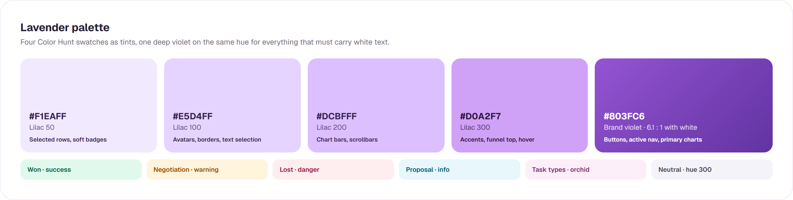

The "Lavender" palette comes from [Color Hunt](https://colorhunt.co/palette/f1eaffe5d4ffdcbfffd0a2f7). None of its four swatches can carry white text (1.2 to 2.1 : 1), so they work as tints: selected rows, soft badges and chart accents. Buttons and the active navigation use a deep violet on the same hue, **#803FC6**, which passes WCAG AA with white at 6.1 : 1. Gradients stay inside one hue, never violet into blue.

The type is Geist, with tabular numerals in every money column. Motion runs 160–260 ms on state changes only and respects `prefers-reduced-motion`. See [DESIGN.md](DESIGN.md) for the full system.

## ✦ Project layout

```
src/
  NexCrm.Domain           OwnedEntity, entities and their rules
  NexCrm.Application      CrudService base, feature services, DTOs, validators, QueryEngine, audit, throttle
  NexCrm.Infrastructure   EF Core on SQLite, migrations, export, JWT, demo seeder, SQL timing
  NexCrm.Api              CrudController base, controllers, Serilog, session check, limits, idempotency
client/                   Angular app
  src/app/core            RecordApi base, auth, interceptors, toasts, formatting
  src/app/shared          DataTable, RecordPage base, LookupSelect, drawer, charts
  src/app/features        dashboard, deals, leads, contacts, companies, tasks, audit
tests/
  NexCrm.UnitTests        domain, validator, service and query-engine tests
  NexCrm.IntegrationTests full HTTP pipeline on a throwaway SQLite database
e2e/                      browser journeys over the Chrome DevTools Protocol
load-tests/               load generator (smoke, load, spike, stress, soak) and the report
security/                 pentest probes and the security review
docs/qa/                  acceptance criteria, QA report, improvement backlog
scripts/
  screenshots.mjs         regenerates images/ with headless Chrome
  readme-art.mjs          renders the banner, hero and palette in images/readme/
images/                   screenshots and README artwork
```

To refresh the images, run both servers with demo data and then:

```bash
node scripts/screenshots.mjs && node scripts/readme-art.mjs
```

<br>

<div align="center">

**NexCRM Lite** · crafted in Karachi

© 2026 [masimaziz.com](https://masimaziz.com/) · [asimhashmi47@gmail.com](mailto:asimhashmi47@gmail.com)

<a href="#top">↑ back to top</a>

</div>
